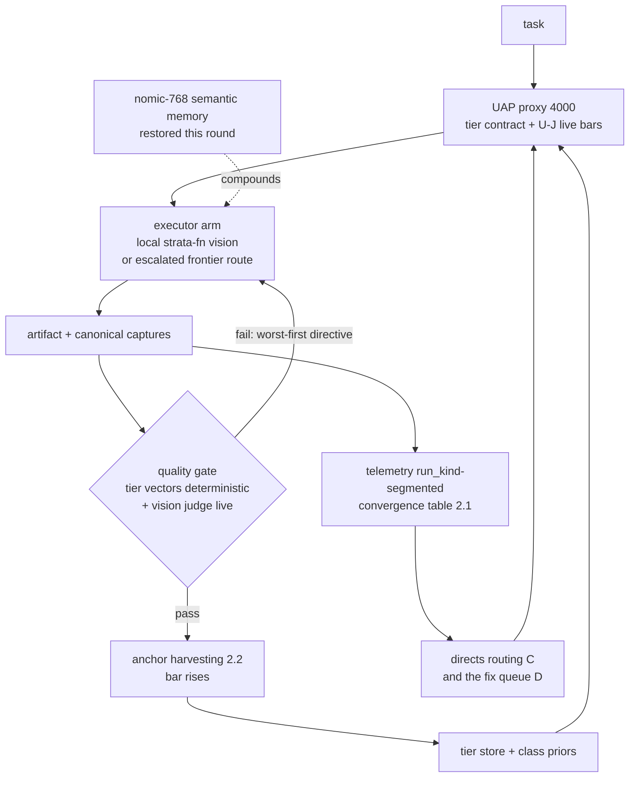

# Frontier-parity uplift plan, 2026-11-23 (monitoring round 5)

**Status:** PROPOSED (plan PR first; nothing below starts without an explicit go,
per the [proof-options house rule](model-performance-proof-options.md))
**Scope:** the Droid Qwen3.8-Flash-Next client fleet's quality-uplift machinery —
frontier parity or better on visual AND non-visual outcomes, including the
innovation / aspiration / ideation axes. Monitoring round 5 findings, the
substrate restorations shipped this round, and the ranked option menu for the
next waves.
**Monitored:** 2026-11-23 07:30–08:10 — the live fleet (strata-fn arm, UAP proxy,
6 droid client processes), `~/.uap/telemetry/tool-calls.db` (Nov 21–22 era,
segmented), the o7-pilot paired reports, and the recall/vision substrates.

## 1. Monitoring state (round 5)

**The fleet is healthy.** Serving: the strata-fn arm (Qwen3.8-FN unsloth
UD-Q4_K_XL) under its own systemd unit — ACTIVE, so the round-3 latch state is
gone — on `:8080`: vision-capable (`images: true`; smoke-tested live: a 1×1 red
pixel answered "Red" through `/v1/chat/completions` image_url), MTP dflash2
drafting at 78% accepted, int8 KV, 131k pool, 81% prompt-cache reuse, 1,869 MiB
VRAM free (reserve-aware). Decode decays 131 → 111 tok/s in the >30k-depth
bucket (n=6/6) — the known R4 decay, unchanged. The proxy (`:4000`) is running
with one registered live client; the global client is `@miller-tech/uap@2.74.1`
symlinked to master — round 2's stale-client finding is resolved.

**Telemetry (Nov 21–22, the o7-pilot era), segmented per the round-3 lesson:**
10,050 calls, 30.8% failed. Fixture traffic is only 106 of the failures — the
era is REAL traffic: 2,994 real failures.

| Class (real paths only) | Count | Concentration |
|---|--:|---|
| edit-miss (edit_file) | 1,840 | stats/central.py 576, spread.py, eval.js 323 — long, heavily-edited files |
| range-invalid (edit_range) | 235 | same benchmark corpus |
| protected-path (guards passing) | 271 | deliberate |
| other-error (edit family) | 327 | — |
| stub-refusal (write_file) | 147 | gutting guard passing |
| path-not-found | 98 | down from era-C zero (small files vs long sessions) |

The o7-pilot runs (armB-gateloop on v2.69.1, armC-teamsolve on v2.70.0, 27
paired cells each) produced these calls. Both reports are correctness-TIE and
**underpowered** (CI ±0.26 contains zero) — efficiency deltas valid, parity
claims not (option G). The loop guardrail caught 112 incidents at streak-2
pivots — working as designed.

**Load-bearing reading:** the O-C hint text is live in every one of the 1,840
miss errors ("re-read the file and match the CURRENT content") — the fixed tool
layer is serving; the model still edits from memory on long files. This is the
long-session blind-write frontier gap at scale, **not a regression**.

## 2. Substrate restorations shipped this round

1. **Qdrant crash-loop fixed.** Two poisoned shard WALs (`agent_memory`,
   `pay2u_memory`, container exit 101 since 2026-11-22 ~20:37) reset with the
   documented known fix after a full backup
   (`~/.cache/uap/backups/qdrant_data-20261123-074232.tar.gz`). Both collections
   green (1,488 + 24,554 points). L3 semantic is ON.
2. **Embedding server restored.** The default endpoint was a stale LAN IP
   (`http://192.168.1.165:8081`; this box moved to `192.168.8.x`), so the
   provider chain degraded to 384-dim TF-IDF hashing and keyword-only recall.
   Now: nomic-embed-text-v2-moe Q4_K_M on llama.cpp b12633, CPU-only (`-ngl 0`,
   zero fleet-GPU impact), loopback `127.0.0.1:8081`, systemd user unit
   `uap-embed-server.service`, enabled. Verified 768-dim; the designed dim
   migration fired (`agent_memory_v768` created; the store test landed there;
   queries run vector-viable). `UAP_EMBEDDING_ENDPOINT` set in `.uap/proxy.env`
   and exported in `~/.profile`.
3. **Vision judge wired.** Fidelity mode is `max` (vision aesthetic review
   BLOCKING at 6/10) but no vision endpoint was configured — while the active
   arm IS vision-capable. Wired `UAP_VISION_ENDPOINT=http://127.0.0.1:8080/v1`
   + `UAP_VISION_MODEL` (the strata arm) through the registered settings.
   Verified: `uap fidelity` now reports the endpoint; blocking review is armed.
4. **Memory store/query verified end-to-end** (write gate passed; the round-5
   memory stored; semantic queries run un-degraded).

**Known-open (reported, operator domain):** decode decay at depth and the
thinking-budget wall (R4-A); the proxy dashboard port `:3847` is held by
another project's process (CLI monitoring unaffected); the project root carries
an uncommitted chmod +x on `tools/agents/scripts/proxy_tier_critique.py` (left
untouched — user working tree); every OTHER project still defaults
`UAP_EMBEDDING_ENDPOINT` to the dead LAN IP (option A fixes the code default).

## 3. Where the frontier gap actually is

**Visual — digitized and closing.** The bar exists: tier waves 0+1 shipped
(anchors, four extractor classes, derive/gap, fresh-critic contract, best-of-N
ladder + escalation, tier contract + per-class sampling, the deliver gate);
the voxel-pagoda reference run closed 7/7 axes against the Fable-5.2-High
tier. U-I ships reference-free frontier regimes (self-measured numeric ranges +
ONE art direction + the baked `visual-scene/frontier-prior`). U-J injects the
resolved numeric bars into every multimodal critique turn. P48 carries the
ambition floor (coverage calculus) and the ideation codex. **Remaining:** pagoda
runs 4 and 6 produced no delivered verdict (ambition-gap repair mid-flight;
run 6 killed at 59 min) — the aspiration axis has no completed reference run;
the vision judge was never in the loop (now unblocked); Wave 2 (convergence
telemetry, anchor harvesting, vision promotion) is unshipped.

**Non-visual — the failure table.** The blind-write class (1,840 edit-misses /
2 days on real paths) is 61% of real failures; the O-B frontier baseline reads
before editing at ~0 misses at 1/24 the tool volume on equal gates. The
economics stack (R4): per-turn thinking floor ~4.3 min at depth. Benchmark
power is the honesty gap (o7 CI ±0.26).

**Innovation / aspiration / ideation — the unmeasured axes.** Aspiration exists
only for visual blueprints (the ambition floor parses task language into
subsystem budgets); no non-visual class has an ambition calculus. Ideation has
the codex + `uap ideate` but no outcome class measures ideation quality (stance
consistency, composition hierarchy, novelty distance) — innovation cannot
converge because nothing scores it. Best-of-N ranks by tier distance but does
not enforce or measure divergence between candidates.

**The loop every option feeds** (four feedback edges, one compounding store):

## 4. The options, ranked

### A. Fix the embedding default in code (small PR, minutes)

`src/memory/embeddings.ts`, `src/cli/memory.ts`, `src/cli/dashboard.ts`
default `192.168.1.165:8081` → `http://127.0.0.1:8081` (+ the variables.md
row; audit the same-family stale `webSearchEndpoint :8888` default in
`src/models/execution-profiles.ts` / `src/types/config.ts` in the same PR).
Every non-repo project still degrades to the dead LAN IP; the profile export
covers only login shells. **Effect:** semantic recall (and pattern-RAG
embedding) fleet-wide with no per-project env.

### B. First vision-scored visual run (free, now unblocked)

Run the next voxel-pagoda attempt under fidelity `max` with the wired
endpoint: vision review BLOCKING at 6/10, tier gate live, U-J bars injected,
P48 regimes declared. **Effect:** the first run where visual quality is policed
by pixel vectors AND a vision model; record vision-score vs tier-vector
agreement per capture — and also complete the first delivered aspiration
reference run (runs 4/6 never delivered). **B is deliberately sequenced BEFORE
E.4:** this run's per-capture agreement log is exactly the input E.4's
promotion decision consumes; E.4 cannot start without it.

### C. Tier-routed sessions (free, one flag — the literal parity-or-better lever)

glm-5.3 as the measured default (O-B: identical gates at 1/24 tool volume,
1/10 wall time), `claude-opus-5-5` / `claude-fable-5.2` for the hardest tier,
local arms for cost-insensitive/background work — combined with the escalation
queue (`.uap/quality/escalations.jsonl`, the 1.4 operator signal).
**Prerequisite, already in place:** the O-B baseline ran glm-5.3 through
Droid's own provider auth (no local keys involved), and the Factory catalog
carries `claude-opus-5-5` and `claude-fable-5.2` as built-ins (opus-5-5 is on
the session favorites list). No new credentials or routes are needed; if a
named route is ever dark, C degrades to the measured glm-5.3 split only.
**Effect:** parity-or-better on the delivered artifact today, while the local
arms close the process gap.

### D. The long-session blind-write class (proxy/tools round, days — the 61%)

1. **Read-freshness contract:** an edit_file/edit_range on a target whose
   content changed since the session last read it (or was never read) returns
   the targeted diff-context error — the O-C auto-context pattern triggered by
   staleness, not only by miss. Implementation: the match/digest/error surface
   in `src/delivery/edit-match.ts` (where the O-C hint text already lives) plus
   the last-read content-hash state held by the executor loop in
   `src/delivery/agentic-executor.ts`.
2. **Nearest-range hint** for edit_range/range-invalid (235) — the same
   `src/delivery/edit-match.ts` seam as the edit-miss fix.
3. **run_kind tagging** at the telemetry classifier —
   `src/telemetry/tool-calls.ts` + `src/telemetry/tool-failure.ts` (covered by
   `test/telemetry/tool-calls.test.ts`) so benchmark and live traffic stop
   blending in the corpus.
   Each is a LOCKSTEP-class fix: paired before/after on the same suite,
   discrimination status reported.

### E. Wave 2 — the measured economics of aspiration

1. **Convergence telemetry (2.1):** iterations-to-tier, escalation frequency,
   cut rate, best-of-N win rate per model per class → the docs/performance
   table that directs C and D with numbers.

   **Shipped (PR this branch):** `scripts/convergence-table.ts`
   (`npm run bench:convergence`) publishes
   [docs/performance/convergence-table.md](../performance/convergence-table.md)
   from three sources — the paired harness corpus (`benchmark-results/`, both
   flat and per-arm layouts, using the harness's own unbiased `passAtK` for
   pass@1/pass@N), the O1 delivery corpus (`uap memory outcomes`), the quality-ladder
   convergence log (`uap quality convergence`, per-tier — the CLASS dimension
   of 2.1, since tier keys are class/name pairs), and the uplift-1.4
   escalation ledger. First real read: on armC-teamsolve, best-of-3
   rescues 29.6% of baseline tasks (pass@1 59.3% → pass@3 88.9%) but only
   18.5% under uap-full (59.3% → 77.8%) — retrying buys more for the bare arm
   than for the scaffolded one, a first measured input for the C routing
   decision. Quality-class coverage is a declared
   empty column until E.2 anchors and E.4 vision-promotion tag runs with
   classes; `tool_calls.db` cannot serve run-level metrics (its run_id/task_id
   are all NULL — per-tool-call only).
2. **Anchor harvesting (2.2):** operator-approved outputs become anchors on the
   approveVisualBaseline precedent — every approved frontier-grade artifact
   raises the bar for free.
3. **Re-embed the legacy collection:** promote the daily-log backlog into
   `agent_memory_v768` (nomic) so semantic recall covers history, not just new
   writes.
4. **Vision promotion (2.3):** consumes B's per-capture agreement log — B is
   its prerequisite, which is why B runs first. Corroboration is promoted once
   the vision score and the tier vectors agree on a measured run set; then
   blind A/B per P39.

### F. The ideation/innovation outcome class (new extractor, days)

Extend the class registry (`src/quality/classes.ts`) with an ideation-outcome
extractor. Axes: stance-consistency (one named stance applied everywhere, P48
rule 1), composition-hierarchy (focal / negative-space / secondary balance),
subsystem-coverage (the ambition floor: task-language nouns vs delivered
subsystems — generalized OUT of visual-only), novelty-distance (embedding
distance of the chosen approach from the nearest prior solution in the
corpus), plus a no-stance degenerate guard (the P48 failure mode fails first).
Then the standard pipeline: anchors from operator-approved exemplars, derive,
gap, ladder — and `uap ideate` candidates get selected by measured novelty
instead of vibes. **Effect:** innovation/aspiration/ideation becomes a digitized
tier exactly the way visual-scene and doc-style did — the gap report can say
"stance-consistency 3/10, novelty-distance at the corpus mode; fix the stance
first."

### G. Power the parity benchmark (free, discipline)

o7-pilot: 9 tasks × 3 epochs → CI ±0.26. Raise epochs (or tasks) until the CI
excludes ±0.25 — or every TIE stays labeled underpowered and carries no claim.
**Effect:** every FORWARD parity claim made by options B, D, E, and F rides a
powered run; the existing o7 TIEs remain labeled underpowered and claim
nothing.

**Shipped (PR this branch):** `assessDiscrimination` now computes the plan
itself — every underpowered verdict (too-few-cells or CI-admits-both) carries a
`powerPlan`: the paired cells needed to pull the CI half-width under the
±minDetectableEffect target, projected from the observed interval (worst-case
`1.96/√n` floor when a tiny run's interval is degenerate), plus `epochsNeeded`
once the task count is known — printed right in the refusal the CLI already
shows ("power plan: at interval ±0.74, ~58 paired cells ⇒ --epochs 7 to exclude
±0.25"). The operator stops guessing epoch counts: re-run the pilot, read the
verdict, spend the GPU it names. The paired-bench CI flake (worker-RPC timeout,
3-for-3 on the #946/#948 runs despite the 2026-10-06 one-worker-per-core cap)
is fixed alongside: CI gets 3 workers on the 4-core runners, leaving one core
of headroom for the suite's python harnesses and downloads.

### H. Wall-clock carryover (R4, unchanged, below D/F)

Thinking-budget discipline on tool turns, decode decay at depth, draft
acceptance tuning (78% → higher). Economics, not quality.

## 5. What NOT to do (the measured history)

- More gates on the Droid path (paired Δ 0.0pp [−5.5, +6.9]).
- Frontier-model routing for interactive sessions beyond C's measured split.
- Full-pin any strata arm (the OOM doctrine).
- Committing anchor/reference media (the P39 licensing rule).
- Unbounded best-of-N (one GPU; farming only on a measured plateau).

## 6. Sequencing

**A** (code default, the next PR) + **C** (routing, today, free) → **B** (the
first scored visual run — it produces E.4's prerequisite data) → **D** (proxy
round: read-freshness + range hints + run_kind) → **E.1/E.2** (telemetry +
harvesting) → **F** (the ideation class) → **G** gates every forward claim the
options above make; **E.3/E.4** as B's data lands; **H** trails.
